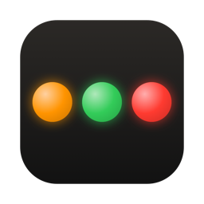

<p align="center"></p>

# Claude Lights

A tiny macOS menu bar app that shows one light for every running
[Claude Code](https://claude.com/claude-code) session:

| Light | Meaning |
|-------|---------|
| 🟠 orange | The agent is working |
| 🟢 green  | The agent finished and replied |
| 🔴 red    | The agent needs you: it asked a question or wants a permission |

Lights appear automatically when a session starts and disappear when it ends.
Click the lights to see every session by project folder. Click a session to bring
its terminal to the front, or ⌥-click it to open the project folder.

## Install

### Download

1. Download `ClaudeLights.zip` from [Releases](../../releases) and unzip it.
2. Move **Claude Lights.app** to `/Applications`.
3. The app is ad-hoc signed, not notarized, so macOS blocks the first launch.
   Right-click the app, choose **Open**, then **Open** again. You can also run:
   ```sh
   xattr -dr com.apple.quarantine "/Applications/Claude Lights.app"
   ```
4. On first launch, click **Install Hooks**.

### Build from source

You need macOS 13+ and Swift 5.9+ (Xcode or the Command Line Tools).

```sh
git clone https://github.com/codepil0t/ClaudeLights.git
cd ClaudeLights
make install      # builds, copies to /Applications and launches
```

Other targets: `make app` (build only: `build/Claude Lights.app` and
`build/ClaudeLights.zip`), `make run`, `make clean`.

Claude Code sessions that were already running pick up the hooks after a restart.

## How it works

```
Claude Code ──hooks──▶ ~/.claude/claude-lights/claude-lights-hook.sh
                                     │ writes
                                     ▼
                    ~/.claude/claude-lights/sessions/<session-id>.json
                                     │ watches
                                     ▼
                           Claude Lights (menu bar)
```

**Install Hooks** adds one command hook to `~/.claude/settings.json` for these events:

| Hook event | Light |
|------------|-------|
| `SessionStart` | 🟢 new session, ready |
| `UserPromptSubmit`, `PreToolUse`, `PostToolUse` | 🟠 working |
| `PreToolUse` for `AskUserQuestion` | 🔴 asking you a question |
| `PermissionRequest`, `Notification` (permission prompt) | 🔴 waiting for permission |
| `Stop` | 🟢 done (🔴 if the reply ends with a question, see below) |
| `SessionEnd` | light removed |

The app also reads the end of each session's transcript to handle a few extra cases:

- **Questions in replies.** If the final reply ends with `?` (e.g. *"Should I also update the docs?"*),
  the light turns red. You can turn this off in the menu with
  *Red Light for Questions in Replies*.
- **Interrupts.** Pressing Esc doesn't fire the `Stop` hook. The app spots the
  interrupt in the transcript and turns the light green.
- **Crashed or killed sessions.** The hook records the `claude` process ID, and the
  light disappears when that process exits.

The hook is a plain `/bin/sh` script that uses only tools that ship with macOS
(`plutil`, `ps`, `sed`). It never prints anything and always exits 0, so it can't
interfere with Claude. It takes about 50 ms per event.

Your existing `settings.json` content and other hooks are kept. Before each
change, a backup is saved to `~/.claude/settings.json.claude-lights-backup`.
Keys are rewritten in sorted order.

### Privacy

Everything stays on your Mac. The app makes no network requests. It only reads the
session files above and the tail of the transcripts Claude Code already writes.

## Menu

- **Clear Finished Sessions**: removes green lights, e.g. for sessions you
  left open but no longer care about.
- **Red Light for Questions in Replies**: see above.
- **Play Sounds**: plays a sound when an agent finishes or needs you. Off by default.
- **Launch at Login**
- **Install / Remove Claude Code Hooks…**

## Command line

```sh
APP="/Applications/Claude Lights.app/Contents/MacOS/ClaudeLights"
"$APP" --status            # print the current lights
"$APP" --install-hooks     # same as the menu item
"$APP" --uninstall-hooks
```

## Uninstall

1. Choose **Remove Claude Code Hooks…** in the menu, or run `--uninstall-hooks`.
2. Quit the app and delete it from `/Applications`.
3. Optionally, `rm -r ~/.claude/claude-lights`.

## Troubleshooting

- **No light for a session:** run `--status`. If it says `hooks installed: no`,
  install the hooks. If the session was started before you installed them,
  restart it. In Claude Code, `/hooks` lists the active hooks.
- **A light is stuck:** ⌥-click it to check which folder it belongs to, or use
  *Clear Finished Sessions*. Session files live in
  `~/.claude/claude-lights/sessions/` and are safe to delete.
- **Clicking a session doesn't focus the right window:** the app activates the app
  that owns the terminal (Terminal, iTerm2, VS Code, …), not a specific tab.
  Sessions inside `tmux` can't be traced to a window.

## Project layout

```
hooks/claude-lights-hook.sh   the Claude Code hook (copied into the app bundle)
Sources/ClaudeLights/         the menu bar app (Swift, AppKit, no dependencies)
Resources/                    Info.plist and the app icon
scripts/build-app.sh          builds and ad-hoc signs the .app and the release zip
scripts/make-icon.sh          regenerates Resources/AppIcon.icns
```

Releases: push a tag like `v0.2.0` and GitHub Actions attaches `ClaudeLights.zip`
to a new release.

---

## По-русски

**Claude Lights** — приложение для строки меню macOS. Оно показывает по лампочке
на каждую запущенную сессию Claude Code:

- 🟠 **оранжевая** — агент работает;
- 🟢 **зелёная** — агент закончил и ответил;
- 🔴 **красная** — агент ждёт вас: задал вопрос или просит разрешение.

Установка: `make install`, затем нажмите **Install Hooks** при первом запуске.
Приложение добавит хук в `~/.claude/settings.json` и сохранит резервную копию.
Новые сессии получат лампочку сразу, уже запущенные — после перезапуска.
Все данные остаются на вашем Mac.

---

Claude Lights is a community project. It is not affiliated with or endorsed by Anthropic.

## License

[MIT](LICENSE)
